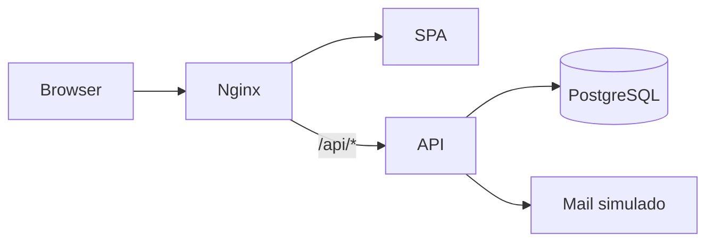

# 01 — Visión y contexto

| Campo | Valor |
| --- | --- |
| Proyecto | CampusFlow · RC-1 (laboratorio estudiantil) |
| Última revisión doc | 2026-10-22 |
| Tipo de sistema | Aplicación web monolítica contenedorizada |

## Propósito técnico

Plataforma ficticia de **inscripciones a actividades** de vida universitaria, usada en talleres de auditoría de código y ciberseguridad. No está pensada para producción ni datos reales.

## Restricciones de contexto

- Ejecución prevista solo en **`127.0.0.1`** (Docker Compose con bind local).
- Correos en dominio **`.test`**; bandeja **simulada** sin salida a Internet.
- Paquete estudiantil **RC-1**: sin RC-2, sin expediente docente completo en build `student`.

## Stakeholders técnicos

| Rol | Interés |
| --- | --- |
| Desarrollo | API Express, SPA React, esquema PostgreSQL |
| Arquitectura | Cuatro servicios Docker, proxy nginx |
| Ciberseguridad | Hallazgos intencionales/típicos de RC-1 (IDOR, logging PII) |
| Docente / alumno | Plantillas en `plantillas/`, escaneos orientativos en README |

## Patrón arquitectónico (resumen)

**Monolito lógico + servicios de infraestructura**: una API de negocio, un frontend estático, BD relacional y micro-servicio de correo simulado. No hay orquestación serverless ni bus de eventos.

## Documentos relacionados

- Funcional: [../funcional/01-proposito-actores.md](../funcional/01-proposito-actores.md)
- Despliegue: [04-despliegue-runtime.md](./04-despliegue-runtime.md)

<!-- TODO(doc): actualizar si se añade RC-2 o cambia el alcance del paquete -->
