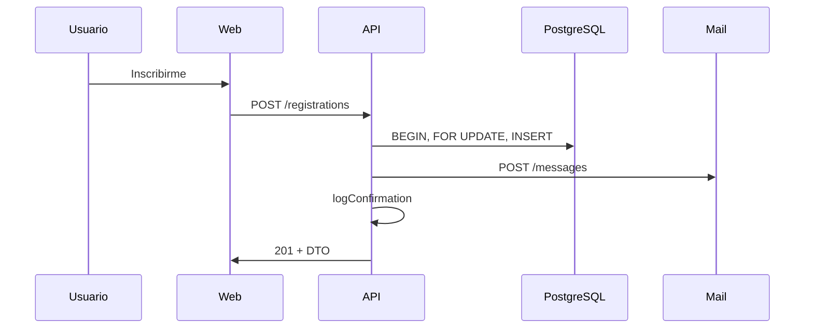

# 05 — Datos e integraciones

| Campo | Valor |
| --- | --- |
| Proyecto | CampusFlow · RC-1 |
| Última revisión doc | 2026-10-22 |

## Persistencia (PostgreSQL)

| Tabla | Descripción |
| --- | --- |
| `actors` | Usuarios: id, nombre, email, rol (`student` \| `coordinator`), `password_hash` |
| `activities` | Actividades con cupo, campus, coordinador opcional |
| `registrations` | Inscripción estudiante–actividad, estado `confirmada`, UNIQUE (activity, student) |

Scripts: `rc1/db/init/01-schema.sql`, `02-seed.sql`.

## Integración correo simulado

- **Protocolo:** HTTP JSON interno (`MAIL_URL`).
- **API mail:** `GET/POST/DELETE /messages` (sin auth RC-1).
- **API negocio:** `sendMail` POST; `listMail` GET; filtrado en `filterMessages` + `visibleRegistrationIds`.

## Integración UI ↔ API

- Browser → `https?://127.0.0.1:8080/api/...` (nginx strip prefix).
- Cliente: `credentials: 'same-origin'`, cookie de sesión.

## Integraciones futuras / muestras

- `rc1/config/integraciones-pago.env.sample`: webhook **inerte** de laboratorio (referencia Gitleaks).

## Flujo de datos — inscripción

Detalle funcional: [../funcional/03-flujos-principales.md](../funcional/03-flujos-principales.md).
