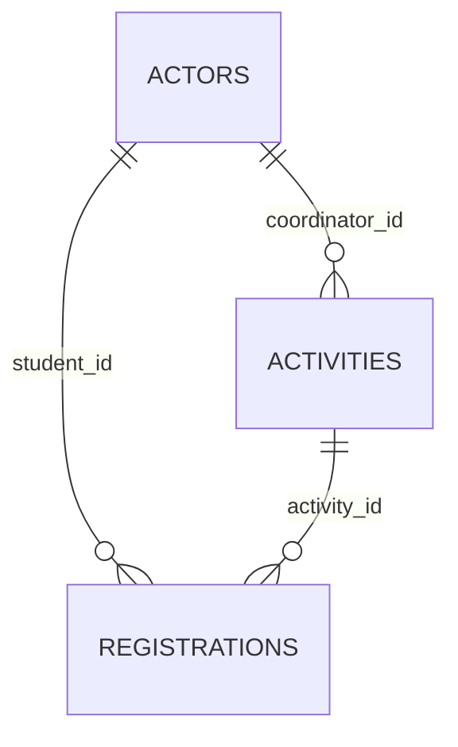

# 04 — Modelo de dominio

| Campo | Valor |
| --- | --- |
| Proyecto | CampusFlow · RC-1 |
| Última revisión doc | 2026-10-22 |

## Entidades

### Actor (usuario)

- **Atributos:** `id`, `display_name`, `email`, `role`, `password_hash`.
- **Reglas:** Email único; rol ∈ {`student`, `coordinator`}.

### Activity (actividad)

- **Atributos:** título, resumen, campus, lugar, `starts_at`, `capacity`, `coordinator_id` (opcional), `coordinator_label`.
- **Reglas:** `capacity > 0`; cupos consumidos = conteo de `registrations`.

### Registration (inscripción)

- **Atributos:** `id`, `activity_id`, `student_id`, `status` (= `confirmada`), `created_at`.
- **Reglas:** Una inscripción por par (actividad, estudiante); id generado `reg-{studentId}-{suffix}`.

## Relaciones

## Reglas de negocio

| ID | Regla |
| --- | --- |
| RN-01 | Solo estudiantes crean inscripciones |
| RN-02 | No inscribir si `taken >= capacity` |
| RN-03 | No duplicar inscripción misma actividad |
| RN-04 | Listados: estudiante ve solo sus registros; coordinadora ve registros de actividades donde es `coordinator_id` |
| RN-05 | Al confirmar inscripción se envía correo simulado con código de verificación en mesa |

## Objetos de valor / artefactos

- **Código verificación mesa (`deskVerificationCode`):** formato `CF-######`, generado en API (RC-1: PRNG no criptográfico — ver seguridad).
